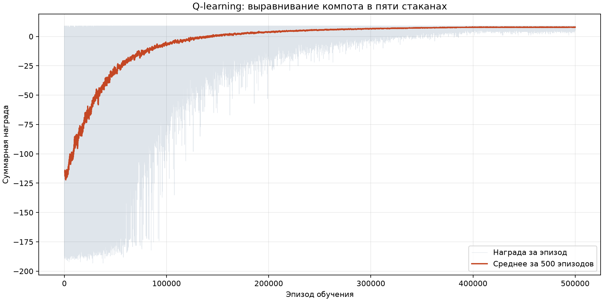

# Практическая работа №4: переливание компота

Агент обучается выравнивать объёмы компота в пяти стаканах с минимальным числом поднятий. Решение — один файл `main.py`, табличный Q-learning и Matplotlib для кривой обучения.

## Запуск

Нужен Python 3.10 или новее. Проверено на Python 3.14 с Matplotlib 3.11.2.

В PowerShell из корня репозитория:

```powershell
cd Practice_4
python -m pip install -r requirements.txt
python main.py
```

Программа проверяет правила среды, обучает агента с нуля, проверяет все начальные распределения и сохраняет рядом с `main.py`:

- `learning_curve.png` — кривую обучения;
- `results.txt` — параметры запуска, итоговую статистику, результат для каждого распределения и четыре пошаговых примера.

Прогресс выводится каждые 10 000 эпизодов. Окно с графиком не открывается: результат сохраняется в PNG. Код завершения 0 означает, что все случаи решены оптимально; при ошибке проверки программа сохраняет отчёт и график и завершается с ненулевым кодом.

Все настройки находятся в начале `main.py`. Для повторяемости используется `SEED = 42`. Q-таблица хранится в памяти; каждый запуск повторяет обучение.

## Принятые правила

Эти параметры уточняют условия, не заданные в исходном задании:

- Пять одинаковых стаканов вместимостью по 4 условные порции, всего 10 порций.
- Объёмы целочисленные; цель — `[2, 2, 2, 2, 2]`.
- Агент знает все объёмы и номер стакана в руке.
- Один шаг — перелить одну порцию из выбранного источника в приёмник.
- Приёмник стоит на столе. Продолжение переливаний из удерживаемого источника, в том числе в другие стаканы, не требует нового поднятия.
- Смена источника означает поставить прежний стакан и поднять новый. Возврат к прежнему источнику после смены также считается поднятием.
- Переливание в тот же стакан, пустой источник и переполнение запрещены. Потерь жидкости нет.
- Эпизод — одна попытка выравнивания. Он заканчивается при равенстве объёмов либо после 200 шагов.

Состояние — `(v1, v2, v3, v4, v5, held)`, где `held = -1` в начале эпизода. Возможны 381 распределение объёмов, включая уже равное; 380 требуют действий. В обучении случайно выбирается одно из этих 380 распределений.

Подробные ответы на вопросы перед программированием находятся в [исследовании](Исследование%20задания%204.md).

## Обучение

Q-таблица — обычный словарь с ключом `(state, action)`. Неизвестные оценки равны нулю. На каждом шаге агент исследует случайное допустимое действие с вероятностью `epsilon`, иначе выбирает максимальную Q-оценку. После шага обновляется одна запись:

```text
Q(s, a) += alpha * (reward + gamma * max Q(s_next, a_next) - Q(s, a))
```

Для последнего шага эпизода будущая оценка равна нулю. Во время обучения равные максимальные оценки разрешаются случайно. При итоговой проверке случайных действий нет, а равенство оценок разрешается фиксированным порядком пар стаканов.

Параметры проверенного запуска:

| Параметр | Значение |
| --- | --- |
| Эпизоды | 500 000 |
| `alpha` | 0.2 |
| `gamma` | 1.0 |
| `epsilon` | От 1.0 до 0.05 за первые 400 000 эпизодов, затем 0.05 |
| Seed | 42 |

Награда за шаг складывается из штрафа `-1` за новое поднятие, штрафа `-0.001` за переливание и бонуса `+10` за успех. При достижении лимита без успеха добавляется штраф `-10`. Если цель достигнута на последнем шаге, штраф за неудачу не применяется.

Награда успешного эпизода равна `10 - поднятия - 0.001 * переливания`. За 200 шагов штраф за переливания не превышает 0.2, поэтому сокращение числа поднятий важнее сокращения числа переливаний. `gamma = 1` сохраняет вес будущих поднятий.

## Проверенный результат

После обучения выполнена проверка без изменения Q-таблицы и без случайного исследования:

| Показатель | Результат |
| --- | --- |
| Проверено неравных распределений | 380 |
| Достигнута цель | 380/380 — 100% |
| Минимальное число поднятий | 380/380 — 100% |
| Уже равное распределение | 0 поднятий, 0 переливаний |
| Записей Q-таблицы | 27 560 |
| Средняя награда первых 1000 эпизодов | -118.529 |
| Средняя награда последних 1000 эпизодов | 7.877 |

Исходные 100 000 эпизодов из плана дали 100% успеха, но только 84.47% оптимальных решений. По предусмотренному в плане правилу число эпизодов увеличено до 500 000; алгоритм остался прежним.

Минимум поднятий для начального распределения равен числу стаканов с объёмом выше 2. Каждый такой стакан необходимо поднять для удаления избытка; одного поднятия каждого достаточно, чтобы распределить излишки по недоливам. Эта формула используется только для оценки результата. Действия агента выбираются по обученной Q-таблице.

Например, агент выполнил:

```text
Начало:         [4, 3, 2, 1, 0]
Стакан 1 -> 5:  [3, 3, 2, 1, 1]  поднятий: 1
Стакан 1 -> 4:  [2, 3, 2, 2, 1]  поднятий: 1
Стакан 2 -> 5:  [2, 2, 2, 2, 2]  поднятий: 2
```

Все проверяемые распределения входят в область обучения. Результат подтверждает решение выбранной конечной задачи; перенос на другие вместимости и объёмы не проверялся.

## Кривая обучения



Полупрозрачная линия показывает реальную суммарную награду каждого эпизода. Оранжевая линия — скользящее среднее за 500 эпизодов, начинающееся с эпизода 500. Рост награды связан и с обучением Q-таблицы, и с уменьшением доли случайных действий. Колебания остаются из-за разных начальных распределений и `epsilon = 0.05` в конце обучения. Оптимальность подтверждается отдельной проверкой, а не формой графика.

## Проверки программы

При каждом запуске до обучения выполняются короткие проверки через `assert`:

- сохранение общего объёма и вместимости для всех допустимых переливаний во всех 381 распределении;
- продолжение переливаний из одного источника без нового поднятия;
- новое поднятие при возвращении к источнику после смены стакана;
- достижение цели на контрольном примере и правильный бонус за успех;
- отсутствие действий при уже равных объёмах;
- запрет переливания в себя, из пустого стакана и в заполненный стакан.

После обучения проверяются все 380 неравных распределений и отдельно равное. Подробные результаты сохранены в [results.txt](results.txt).
